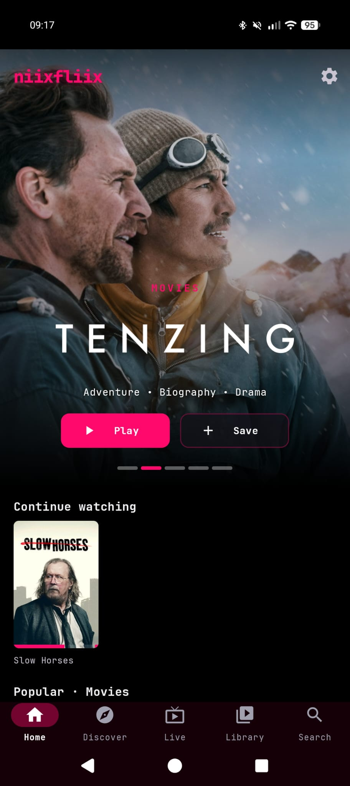
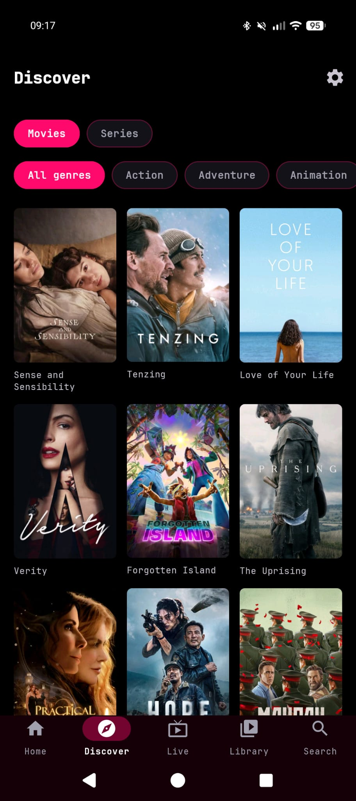
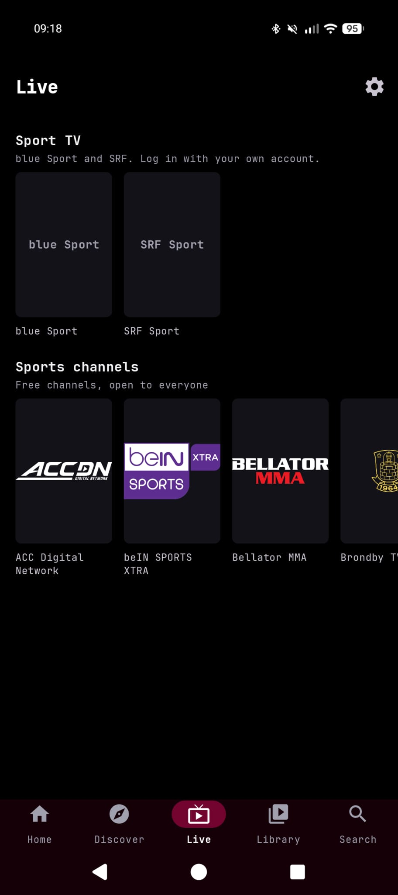
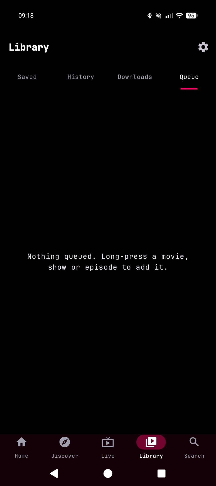

<h1 align="center">
  
</h1>

  still working on it ... consider this an alpha release

A native Android and Linux app for the public Stremio add-on protocol. Browse movies and series,
open one, pick a stream, watch it. Any Stremio add-on works; Cinemeta, Torrentio, ThePirateBay+
and OpenSubtitles come installed.

- **Torrents play straight away** with the built-in engine: one stream per quality (2K, 1080p,
  720p, 480p), the one with the most seeds. A Torrentio link set up with a debrid service gives
  plain links that start at once
- **Only the real thing.** Trailers, samples, "premium only" notices, cams, telesyncs, screeners
  and upscaled copies are left out, so every stream in the list is the full film or episode
- **Quick to start:** opening a title already asks the add-ons and gets the torrent going, so Play
  usually starts the video at once, and the next episode is lined up before this one ends
- **Home and Discover** with a rotating banner, Continue watching, a row for every catalog,
  genres from all your sources, and "More like this" from Wikidata
- **A player that keeps going:** background playback with lock-screen controls, a mini bar while
  you browse, picture in picture, brightness and volume slides, and a lock for pockets and kids
- **Library, queue, history and downloads**, with watched titles greyed out and "NEW" on a saved
  series when a new episode is out
- **Live TV:** the live catalogs of your add-ons, free sports channels, and blue Sport and SRF
  Sport with your own account. Only what plays right now is listed
- **A Stremio account is optional.** Sign in and your add-ons and library come along; everything
  works without one
- **Phones, tablets and TVs** with Android 8.0 or newer, and **Linux** as a native GTK 4 app in a
  Flatpak (x86_64)
- **Signed updates** from GitHub on both, only installed when they're signed with the app's own key
- **9 languages:** English, Spanish, French, Russian, Turkish, Japanese, Korean and Chinese
  (simplified and traditional)

Requires Android 8.0 or newer, or 64-bit Linux with Flatpak. Download the APK or the `.flatpak`
from [Releases](https://github.com/techniixdotcom/niixfliix/releases); the apps check for updates
themselves after that.

How it works, how to build it, and the full documentation:
[`docs/HOW-IT-WORKS.md`](docs/HOW-IT-WORKS.md).

## What it can't do

- **It contains no media and hosts no streams.** It's a player and add-on client: what you can
  watch comes from the add-ons, which are run by third parties, and you are responsible for what
  you watch. niixfliix is not affiliated with Stremio.
- **Torrents show your IP address** to the other peers, as BitTorrent does. A debrid service
  avoids that.
- **Torrents can only be played, not downloaded.** Downloading needs a stream with a direct link,
  such as from a debrid service.
- **Paid matches aren't on the free sports channels**, and blue Sport and SRF Sport need your own
  account and only play inside Switzerland.
- **Protected video doesn't play on Linux:** blue Sport and SRF Sport open in your browser there,
  and so do trailers.
- **Accounts can't be created in the app**: sign in with an existing Stremio account, or use it
  without one.
- **Linux only on x86_64**, as a Flatpak, and there's no iPhone, Windows or macOS app.
- **It's an alpha.** It's still being worked on, so expect rough edges.

## The Look

  
  
  
  

## Licence

The app's own code is free software under the MIT licence: you can use, study, change and share
it. The Android app bundles Jellyfin's FFmpeg audio decoder, which is GPL-3.0, so an APK you
distribute falls under GPL-3.0 terms and its source has to be available. It comes with no
warranty. The full text is in [`LICENSE`](LICENSE), and the licences of everything the apps
include are at the end of [`docs/HOW-IT-WORKS.md`](docs/HOW-IT-WORKS.md#more).

  Peace and Love 
  techniix / cuteLiLi / QuacK / decoi

